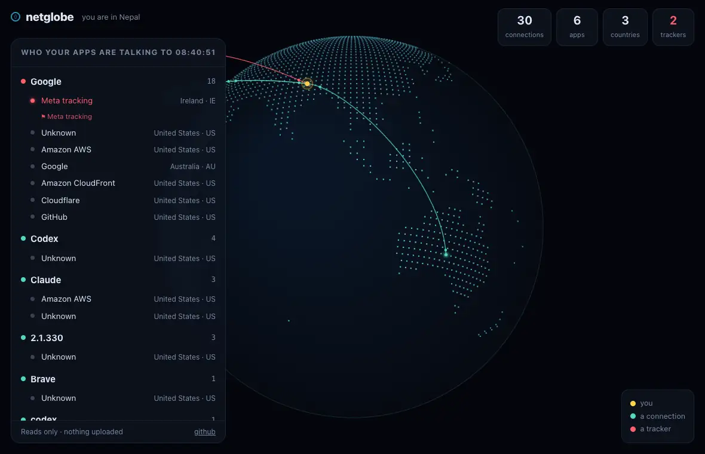

<div align="center">

# netglobe

**Where does your data go? A live globe of every connection your Mac makes — which app, which company, which country, and who's tracking you.**

One command. Read-only. Nothing uploaded. Zero dependencies.

[](https://github.com/annapurnageeks/netglobe/actions/workflows/ci.yml)
[](#run-it)
[](#run-it)
[](netglobe.py)
[](#how-it-works)
[](LICENSE)



**[▶ Open the live demo](https://annapurnageeks.github.io/netglobe/)** (sample data) · or run it on your own Mac in 10 seconds

</div>

---

## Run it

```bash
git clone https://github.com/annapurnageeks/netglobe
python3 netglobe/netglobe.py
```

It opens a spinning globe in your browser. Every few seconds it finds the connections your apps have open and
draws an arc from you to each one. **No admin, no install, no account** — it uses `lsof`, which any Mac already
has, and the country lookup is a table bundled with the tool, so the addresses you talk to never leave your
machine.

Prefer the terminal?

```bash
python3 netglobe/netglobe.py --once      # one text snapshot, grouped by app
python3 netglobe/netglobe.py --json      # machine-readable
```

## What you'll see

- **A dot for every server** your apps are connected to, placed on the globe by country.
- **An arc from you to each one.** Connections to **trackers and ad networks glow red**.
- **A panel** grouping connections by app, so you can see that your weather app talks to three analytics
  companies, or that a single web page reached eight ad exchanges.
- **The companies behind the addresses** — Google, Amazon AWS, Cloudflare, Meta, a long list of trackers — found
  from reverse DNS and a bundled table of known networks.

It's the quiet background chatter of your computer, made visible. Most people are surprised.

## Who it flags as a tracker

netglobe knows the big analytics, advertising, attribution and session-replay networks: Google Analytics,
DoubleClick, Meta, Criteo, The Trade Desk, AppNexus, Taboola, Segment, Mixpanel, Amplitude, Sentry, Hotjar,
AppsFlyer, Adjust and more. A red arc means something on the other end is in the business of profiling you.

## How it works

1. **See the connections.** `lsof -nP -iTCP -sTCP:ESTABLISHED` lists every open outbound connection with the app
   that owns it. No packet capture, so no `sudo`.
2. **Name the other end.** A reverse-DNS lookup plus a bundled table of well-known networks turns a bare IP into
   "Google", "Cloudflare", "a tracker", or the domain it belongs to.
3. **Place it on Earth.** A bundled, offline IP-to-country table (built from the public [Regional Internet
   Registry](https://www.nro.net/about/rirs/) delegation files, IPv4 **and** IPv6) maps each address to a country,
   and the country to a point on the globe.
4. **Draw it.** The globe is a dotted sphere rendered on a canvas from a tiny bundled land map, with arcs to each
   live destination. Drag to spin it.

Everything runs locally. netglobe makes **no network requests of its own** — not even for geolocation.

## It only watches

netglobe reads; it never changes anything. It can't block a connection, kill a process or modify your traffic,
and it has no way to send your data anywhere. The "you are here" point is your system region (override with
`--home US`), not your real location, and it isn't looked up online.

## Options

```
python3 netglobe.py [options]

  --home CC     your country code for the "you" marker (default: your system region)
  --once        print one text snapshot and exit
  --json        print the current connections as JSON and exit
  --port 8765   local port
  --no-open     don't open the browser
```

## Honest limits

- **Country-level, not street-level.** An IP tells you the country and the company, not a street address. A US
  cloud server could be serving a European company.
- **It sees connections, not content.** netglobe shows *that* your app talked to Google, not *what* it said.
  HTTPS keeps the content private from everyone, including netglobe.
- **Some addresses are unknown.** A server with no reverse DNS that isn't in a known range shows as its domain or
  "Unknown". That's normal.
- **macOS only, for now.** Linux (`ss`/`/proc`) is on the roadmap.

## Let an AI read it with you

netglobe is a [Claude Code skill](SKILL.md). Ask Claude Code "what is my Mac connecting to?" and it runs a
snapshot, explains which connections are expected and which are worth a look, and points out the trackers.

## Contributing

Run the tests with `python3 -m unittest discover tests` — they check the engine (lsof parsing, offline
geolocation, tracker detection) with canned data, so they need no network. The bundled data files in `data/` are
rebuilt from public sources; see `examples/`. New tracker signatures and Linux support are very welcome.

Also by me: **[rathunter](https://github.com/annapurnageeks/rathunter)** (finds spyware on your Mac),
**[twinradar](https://github.com/annapurnageeks/twinradar)** (is this Wi-Fi safe?), and
**[agentheist](https://github.com/annapurnageeks/agentheist)** (a prompt-injection game).

## Data credits

Country boundaries from [Natural Earth](https://www.naturalearthdata.com/) (public domain). IP-to-country from the
[RIR](https://www.nro.net/about/rirs/) delegation files (public). Country centroids from
[eesur/country-codes-lat-long](https://github.com/eesur/country-codes-lat-long).

## License

[MIT](LICENSE)
